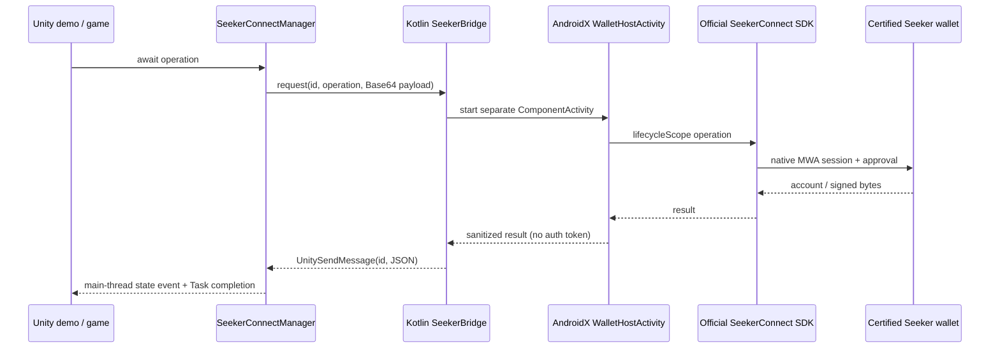

# Seeker Connect for Unity

A reusable Unity package and Android demo for Solana Mobile's **official Kotlin Seeker Connect SDK**. Connect a certified wallet, restore authorization, display its actual public key, sign UTF-8 messages, and sign serialized Solana transactions through native wallet approval.

**This is an independently developed community wrapper, not an official Solana Mobile Unity SDK.** There are no simulated wallet responses. Editor Play mode previews the UI and explicitly reports that Android wallet operations are unavailable.

The demo now enables **Devnet MWA testing mode**, so Mock MWA Wallet can be used on ordinary Android phones. The reusable SDK still defaults to certified Seeker wallets only. Testing mode uses the official SDK's generic MWA fallback, not fabricated responses.

## Validation status

See [the validation record](docs/VALIDATION.md) for build results and the exact verification boundary. No Seeker or Android device was connected during development: real wallet approval, signatures, and device lifecycle behavior still require the device checklist below. Do not interpret compilation or unit tests as a completed wallet-device test.

## Quick start

1. Clone this repository and open its root as a Unity project using **6000.6.0f1**, with Android Build Support, SDK/NDK, and OpenJDK installed.
2. Open `Assets/SeekerConnectDemo/Scenes/SeekerConnectDemo.unity`.
3. Choose **Seeker Connect → Build Android APK**, or use the command below. The output is `Builds/SeekerConnectDemo.apk`.
4. Install the APK on your Android phone. Open Mock MWA Wallet and tap **Authenticate**, then return to the demo. The editable demo identity points to this project's GitHub repository; supply your own website and hosted icon for your application.
5. Tap **Connect with MWA test wallet**, approve in the wallet, and check the returned address. Tap **Sign Message**, approve, and inspect the Base64 Ed25519 signature. A Seeker is still needed to validate the certified-wallet experience.

```powershell
unity run . --timeout 1800 -- -buildTarget Android -executeMethod DemoBuilder.BuildApk
# With Android platform-tools on PATH:
adb install -r Builds/SeekerConnectDemo.apk
```

The installed editor available for this project was Unity 6.6 `6000.6.0f1`, not a Unity 6 LTS release. It was selected rather than inventing an unavailable LTS installation. Older Unity 6 LTS editors require compatible Android build tooling; see [build setup](docs/BUILDING.md). Only the recorded editor/toolchain is verified.

## API

Call from the Unity main thread after runtime startup, for example in `Start()` or a UI callback. Await the tasks and handle `SeekerConnectException.Code`.

```csharp
using Community.SeekerConnect;

await SeekerConnectManager.InitializeAsync(new SeekerConnectConfig {
    appName = "My Game",
    identityUri = "https://your-app.example", // replace with your real website
    iconPath = "images/icon.png",            // hosted relative to identityUri
    chain = "solana:devnet"
});

SeekerConnectManager.ConnectionStateChanged += state => UpdateWalletUI(state);
var session = await SeekerConnectManager.RestoreSessionAsync();
if (session == null) session = await SeekerConnectManager.ConnectAsync();
string address = session.Account.address;
var signature = await SeekerConnectManager.SignMessageAsync("Hello from Unity Seeker Connect!");
byte[] signed = await SeekerConnectManager.SignTransactionAsync(serializedTransaction);
await SeekerConnectManager.DisconnectAsync();
```

`SignAndSendTransactionAsync` is available when the wallet advertises support. Its returned signature means **submission**, not confirmation. Query Solana RPC for confirmation. After timeout/session loss/cancellation, the transaction may already have been sent: **never retry automatically**.

## Package installation

In another compatible Unity project, use Package Manager → Install package from Git URL:

```text
https://github.com/CryptoSodi/solana-seeker-connect-unity.git?path=Packages/com.community.seekerconnect.unity
```

Pin a tag or commit for reproducibility, or copy the complete `Packages/com.community.seekerconnect.unity` directory into the destination project's `Packages` folder. Keep `Native~`: it contains the native source, manifest, consumer rules, resources, and Gradle module. The package's editor callback adds that module to Android builds; no manually copied AAR or external dependency resolver is required. Configure IL2CPP, ARM64, minimum SDK 26, and target SDK 36. [Full installation/build instructions](docs/BUILDING.md).

## Architecture



Unity's installed `UnityPlayerActivity` directly extends `android.app.Activity`, not `ComponentActivity`. A separate, non-exported AndroidX activity supplies the SDK's activity-result registry without replacing Unity's renderer. Rotation/UI-mode changes stay in that host; real recreation cancels rather than replaying a request. Process death loses outstanding C# tasks, as any process-local task would; the next app launch restores the official cache. [Lifecycle and security details](docs/ARCHITECTURE.md).

## Layout

| Path | Purpose |
| --- | --- |
| `Assets/SeekerConnectDemo` | Scene, UI Toolkit theme, Devnet memo builder, build menu |
| `Packages/com.community.seekerconnect.unity/Runtime` | Task API, typed models, callback routing |
| `Packages/com.community.seekerconnect.unity/Editor` | Gradle module integration and backup protection |
| `Packages/com.community.seekerconnect.unity/Native~` | Canonical Kotlin library source and native tests |
| `NativeAndroid` | Standalone Gradle harness and pinned wrapper |
| `scripts` | Local native build/test helper |
| `docs` | Architecture, API, testing, troubleshooting, and build records |

## Dependencies and scope

The package resolves `com.solanamobile:seeker-connect:0.2.0` from Maven Central, including its core, AndroidX activity, and MWA client transitive dependencies. The build uses AGP 9.0.0, Gradle 9.1.0, Kotlin 2.4.10, coroutines 1.11.0, and lifecycle 2.11.0. Exact SDK API signatures were checked against official source and the published source artifact. [Research notes and references](docs/RESEARCH.md).

The default Seeker provider rejects `OTHER` and `NONE` wallet availability. Set `allowMwaTesting = true` with `chain = "solana:devnet"` to allow `OTHER` through the official SDK's MWA fallback. Missing wallets are still rejected, and test authorizations use a separate cache from certified-only mode. Jupiter Wallet and Play Solana PSG1 compatibility is not assumed. Solana.Unity-SDK can optionally be used by the host game to construct transactions; it is not a dependency.

## Documentation

- [Build, export, and identity setup](docs/BUILDING.md)
- [C# API and error reference](Packages/com.community.seekerconnect.unity/Documentation~/API.md)
- [Architecture, lifecycle, and security](docs/ARCHITECTURE.md)
- [Device testing and troubleshooting](docs/TESTING.md)
- [Verification record and limitations](docs/VALIDATION.md)

Original wrapper/demo code is MIT licensed. Dependencies retain their licenses; see [third-party notices](THIRD_PARTY_NOTICES.md).
