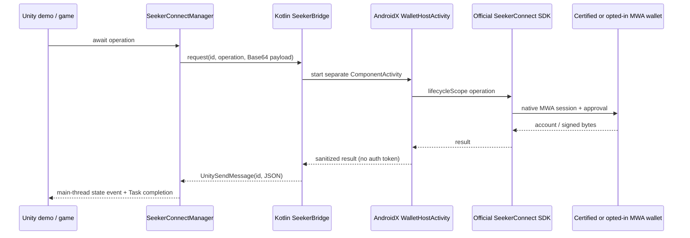

# Seeker Connect for Unity

A reusable Unity package and Android/WebGL demo for Solana Mobile's **official Seeker Connect SDKs**: Kotlin on Android and `@solana-mobile/seeker-connect-web` in WebGL. Connect a wallet, restore authorization, display its public key, and request message or transaction signatures through wallet approval.

**This is an independently developed community wrapper, not an official Solana Mobile Unity SDK.** Production wallet operations use the official SDKs. Editor Play mode previews the UI; automated web tests use an isolated wallet fixture.

**WebGL:** see [web setup and testing](docs/WEB.md). The same C# API calls the official web SDK. Supply a Nostr relay hostname; real wallet testing requires a compatible wallet.

The demo now enables **Devnet MWA testing mode**, so Mock MWA Wallet can be used on ordinary Android phones. The reusable SDK still defaults to certified Seeker wallets only. Testing mode uses the official SDK's generic MWA fallback, not fabricated responses.

**Android production wallets (0.2.1):** set `allowGenericMwa = true` and leave `allowMwaTesting = false` to permit compatible MWA wallets on ordinary Android phones, including Mainnet. Strict production payload validation remains enabled. The official SDK prefers the certified endpoint on first connection and falls back to the Android wallet chooser; subsequent interactions prefer the learned wallet endpoint. Jupiter device compatibility is pending validation. See [Android wallet policy and restoration](docs/ANDROID_WALLETS.md).

## Validation status

**0.2.2 Android signing fix:** accepts either full signed payloads or detached 64-byte responses only after Ed25519 verification against the exact original message and account public key. Invalid signatures return `INVALID_RESPONSE`; account changes during reauthorization return `ACCOUNT_CHANGED` before signing. Both clear local authorization so the next explicit Connect starts fresh. No automatic signing retry or transaction submission is performed. Earlier 0.2.1 production builds reject detached responses; upgrade for this fix.

For **0.2.2**, **36 native tests and 18 Unity EditMode tests passed**, including independent signature verification, invalid-response rejection, changed-account prevention, token/cache cleanup, and C# disconnected-state reporting. These are automated tests; live phone validation still requires rebuilding the consumer app. No app was built or deployed for this patch.

See [the validation record](docs/VALIDATION.md) for build results and the exact verification boundary. The demo has been tested on a Samsung SM-S918B with Mock MWA Wallet: connection, independently verified message/transaction signatures, rejection, restoration after relaunch, and disconnect. Certified Seeker routing and the remaining lifecycle/submission checklist still require further device testing.

For **0.2.1**, all **29 native tests and 16 Unity EditMode tests passed**. Coverage includes production configuration on supported chains, serialization of the new opt-in, mock-mode restrictions, cache isolation, and restoration of seeded production authorization across client recreation followed by disconnect and empty restore. Existing strict message-signature and transaction tests also passed. The restoration regression uses a simulated Android wallet environment, not a live Jupiter wallet.

Physical Jupiter approval/signing/restoration, certified Seeker routing, and real sign-and-send submission remain pending. No APK or WebGL player was built or deployed for the 0.2.1 change; installing this source version does not update a previously installed demo APK. The work did not modify Battle Cities or replace its existing wallet providers.

## Production Android wallets and Jupiter

The wrapper supports compatible ordinary Android MWA wallets through the official Seeker Connect Android SDK. Configure production use separately from mock testing:

```csharp
await SeekerConnectManager.InitializeAsync(new SeekerConnectConfig {
    appName = "My Game",
    identityUri = yourHttpsIdentity,
    iconPath = "images/icon.png",
    chain = "solana:mainnet", // Match your application's and wallet's supported network.
    allowGenericMwa = true,
    allowMwaTesting = false
});
```

| Configuration | Accepted Android wallets | Networks | Validation and cache |
| --- | --- | --- | --- |
| Both flags false (default) | Certified wallets | Devnet, Testnet, Mainnet | Strict validation; existing certified-only cache |
| `allowGenericMwa = true`, testing false | Certified or compatible MWA wallets | Devnet, Testnet, Mainnet | Strict validation; separate production MWA cache |
| `allowMwaTesting = true`, either generic flag value | Certified or compatible MWA wallets, including Mock MWA Wallet | Devnet only | Verified signatures; existing testing cache |

The production flag does not relax signature or transaction payload validation. Since 0.2.2, all Android modes accept full or detached message-signature responses only after cryptographic verification; mock mode does not bypass verification. Enabling both flags still rejects Mainnet and Testnet in C# and Kotlin. Both flags default to false, and existing certified-only and testing cache names remain unchanged. These Android options do not change the WebGL transport.

The official SDK first tries a previously learned wallet endpoint, then the certified Seeker endpoint, then generic MWA through Android. On first connection, certified routing remains preferred. On an ordinary Android phone, install and configure Jupiter Wallet and select it if Android presents a wallet chooser. Compatibility still needs testing with the intended Jupiter version and phone.

The pinned official SDK has no public package-name targeting option. Its native configuration supports a first-connect wallet URI, but overriding that changes certified first-connect routing; this wrapper does not expose that override or hard-code an unverified Jupiter URI. A wallet URI learned during authorization can be reused for subsequent interactions. See [Android wallet routing and device checks](docs/ANDROID_WALLETS.md).

## Restoring a session after relaunch

Yes: initialize once on app startup, then explicitly restore using the same app identity, chain, and wallet policy:

```csharp
var session = await SeekerConnectManager.RestoreSessionAsync();
if (session != null) {
    // Display session.Account.address as the cached wallet account.
} else {
    // Show a Connect button. Its handler awaits ConnectAsync().
}
```

Restoration loads cached authorization without asking the wallet for approval. The next signing request opens a new wallet interaction and reauthorizes; a revoked or expired grant may require an explicit reconnect. Restoration is not a persistent live connection and does not guarantee that the next signature request will succeed. Handle `SeekerConnectException` in the caller.

Certified-only, production MWA, and mock-testing sessions use separate caches, additionally scoped by identity and network. Switching from mock testing to production requires connecting once in the production mode. No authorization tokens are migrated between policies. `DisconnectAsync()` clears the active configuration's local cache; it does not revoke the wallet-side grant or automatically sign out of a game's backend.

A restored address is **not backend authentication**. Preserve server-issued login challenges and server-side signature verification. Preserve server transaction validation and confirmation for checkout. Adding this provider does not require replacing Phantom web support or an existing PSG1/Jupiter flow; those integrations must retain their own routing and validation.

To intentionally switch wallet apps, await `DisconnectAsync()` before `ConnectAsync()`. Connect alone may return the existing cached account. After `INVALID_RESPONSE` from message verification or `ACCOUNT_CHANGED`, 0.2.2 has already cleared that local authorization: show Connect, then obtain a new server challenge for the newly selected account. A cached reauthorization rejected with `AUTHORIZATION_DECLINED` is also cleared by the official SDK. Cancellation or ordinary signing rejection does not automatically clear a valid session.

## Quick start

1. Clone this repository and open its root as a Unity project using **6000.6.0f1**, with Android Build Support, SDK/NDK, and OpenJDK installed.
2. Open `Assets/SeekerConnectDemo/Scenes/SeekerConnectDemo.unity`.
3. Choose **Seeker Connect → Build Android APK**, or use the command below. The output is `Builds/SeekerConnectDemo.apk`.
4. Install the APK on your Android phone. Open Mock MWA Wallet and tap **Authenticate**, then return to the demo. The editable demo identity points to this project's GitHub repository; supply your own website and hosted icon for your application.
5. Tap **Connect with MWA test wallet**, approve in the wallet, and check the returned address. Tap **Sign Message**, approve, and inspect the Base64 Ed25519 signature. A Seeker is still needed to validate the certified-wallet experience.

```powershell
unity run . --timeout 1800 -- -buildTarget Android -executeMethod DemoBuilder.BuildApk
# With Android platform-tools on PATH:
adb install -r Builds/SeekerConnectDemo.apk
```

The installed editor available for this project was Unity 6.6 `6000.6.0f1`, not a Unity 6 LTS release. It was selected rather than inventing an unavailable LTS installation. Older Unity 6 LTS editors require compatible Android build tooling; see [build setup](docs/BUILDING.md). Only the recorded editor/toolchain is verified.

## API

Call from the Unity main thread after runtime startup, for example in `Start()` or a UI callback. Await the tasks and handle `SeekerConnectException.Code`.

```csharp
using Community.SeekerConnect;

await SeekerConnectManager.InitializeAsync(new SeekerConnectConfig {
    appName = "My Game",
    identityUri = "https://your-app.example", // replace with your real website
    iconPath = "images/icon.png",            // hosted relative to identityUri
    chain = "solana:devnet"
});

SeekerConnectManager.ConnectionStateChanged += state => UpdateWalletUI(state);
var session = await SeekerConnectManager.RestoreSessionAsync();
if (session == null) session = await SeekerConnectManager.ConnectAsync();
string address = session.Account.address;
var signature = await SeekerConnectManager.SignMessageAsync("Hello from Unity Seeker Connect!");
byte[] signed = await SeekerConnectManager.SignTransactionAsync(serializedTransaction);
await SeekerConnectManager.DisconnectAsync();
```

`SignAndSendTransactionAsync` is available when the wallet advertises support. Its returned signature means **submission**, not confirmation. Query Solana RPC for confirmation. After timeout/session loss/cancellation, the transaction may already have been sent: **never retry automatically**.

## Package installation

In another compatible Unity project, use Package Manager → Install package from Git URL:

```text
https://github.com/CryptoSodi/solana-seeker-connect-unity.git?path=Packages/com.community.seekerconnect.unity
```

To pin the tested **0.2.2 implementation**, including the Android signing and session-recovery fix:

```text
https://github.com/CryptoSodi/solana-seeker-connect-unity.git?path=Packages/com.community.seekerconnect.unity#2af326d4855407537b95f217aa0a4c1bfc89176b
```

[0.2.2 implementation commit: `2af326d4855407537b95f217aa0a4c1bfc89176b`](https://github.com/CryptoSodi/solana-seeker-connect-unity/commit/2af326d4855407537b95f217aa0a4c1bfc89176b). The current wrapper package version is 0.2.2; its official Android and web SDK dependencies remain 0.2.0. Android message verification adds `org.bouncycastle:bcprov-jdk18on:1.86` using its lightweight Ed25519 API without registering a global JCA provider.

Pin a tag or commit for reproducibility, or copy the complete `Packages/com.community.seekerconnect.unity` directory into the destination project's `Packages` folder. Keep `Native~`: it contains the native source, manifest, consumer rules, resources, and Gradle module. The package's editor callback adds that module to Android builds; no manually copied AAR or external dependency resolver is required. Configure IL2CPP, ARM64, minimum SDK 26, and target SDK 36. [Full installation/build instructions](docs/BUILDING.md).

## Architecture



Unity's installed `UnityPlayerActivity` directly extends `android.app.Activity`, not `ComponentActivity`. A separate, non-exported AndroidX activity supplies the SDK's activity-result registry without replacing Unity's renderer. Rotation/UI-mode changes stay in that host; real recreation cancels rather than replaying a request. Process death loses outstanding C# tasks, as any process-local task would; the next app launch restores the official cache. [Lifecycle and security details](docs/ARCHITECTURE.md).

## Layout

| Path | Purpose |
| --- | --- |
| `Assets/SeekerConnectDemo` | Scene, UI Toolkit theme, Devnet memo builder, build menu |
| `Packages/com.community.seekerconnect.unity/Runtime` | Task API, typed models, callback routing |
| `Packages/com.community.seekerconnect.unity/Editor` | Gradle module integration and backup protection |
| `Packages/com.community.seekerconnect.unity/Native~` | Canonical Kotlin library source and native tests |
| `NativeAndroid` | Standalone Gradle harness and pinned wrapper |
| `scripts` | Local native build/test helper |
| `docs` | Architecture, API, testing, troubleshooting, and build records |

## Dependencies and scope

The package resolves `com.solanamobile:seeker-connect:0.2.0` from Maven Central, including its core, AndroidX activity, and MWA client transitive dependencies. The build uses AGP 9.0.0, Gradle 9.1.0, Kotlin 2.4.10, coroutines 1.11.0, and lifecycle 2.11.0. Exact SDK API signatures were checked against official source and the published source artifact. [Research notes and references](docs/RESEARCH.md).

The default Seeker provider rejects `OTHER` and `NONE` wallet availability. Set `allowGenericMwa = true` for production-compatible generic wallets, or `allowMwaTesting = true` with `chain = "solana:devnet"` for mock testing. Missing wallets are still rejected. Jupiter Wallet and Play Solana PSG1 device compatibility is not assumed. Solana.Unity-SDK can optionally be used by the host game to construct transactions; it is not a dependency.

## Documentation

- [Build, export, and identity setup](docs/BUILDING.md)
- [Android production wallets, Jupiter selection, and session restoration](docs/ANDROID_WALLETS.md)
- [C# API and error reference](Packages/com.community.seekerconnect.unity/Documentation~/API.md)
- [Architecture, lifecycle, and security](docs/ARCHITECTURE.md)
- [Device testing and troubleshooting](docs/TESTING.md)
- [Verification record and limitations](docs/VALIDATION.md)

Original wrapper/demo code is MIT licensed. Dependencies retain their licenses; see [third-party notices](THIRD_PARTY_NOTICES.md).
